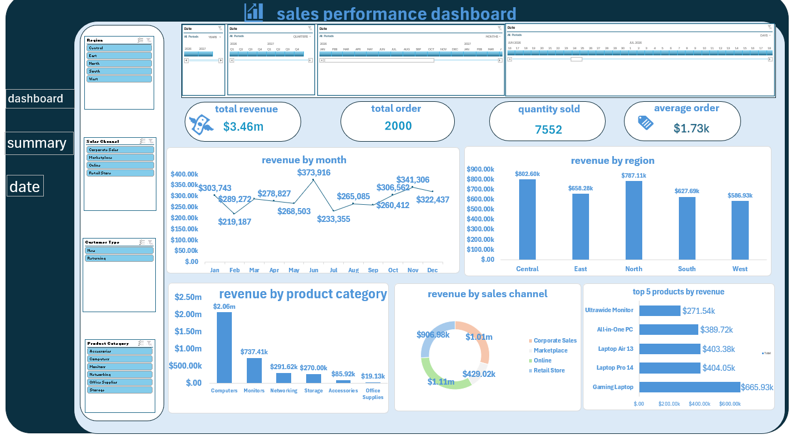

# Sales Performance Excel Dashboard

Interactive Excel dashboard that tracks sales performance by month, region, product category, sales channel and product.

**Tools:** Excel PivotTables, PivotCharts, slicers and timelines, plus KPI cards for total revenue, total orders, quantity sold and average order value.

**Key findings:** Total revenue of $3.46M from 2,000 orders and 7,552 units sold, with an average order of $1.73K. Computers drive more than half of revenue, the Gaming Laptop is the top product, and Central is the top region.

